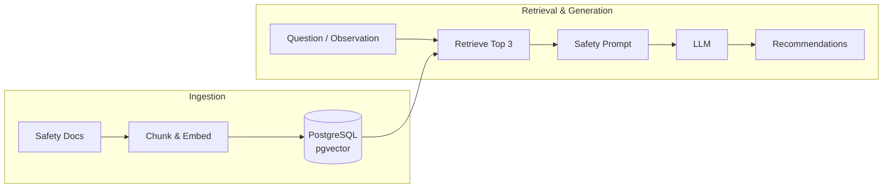
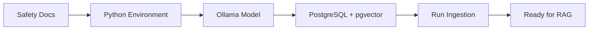

# RAG (Retrieval-Augmented Generation) System

This directory contains GazeLoop's retrieval-augmented generation (RAG) components. RAG gives the language model relevant passages from the project's safety documents at request time, rather than asking it to rely only on its training data. 

## Architecture



## What it does

The current knowledge source is `knowledge/fall_response.md`. Its Markdown `##` sections are turned into chunks, embedded with `Ollama's` `nomic-embed-text` model, and stored in PostgreSQL with the pgvector extension. At query time, the question or visual description is embedded and compared with stored vectors; the nearest passages are included in a policy-constrained prompt.

```text
knowledge/fall_response.md
        -> split at ## headings
        -> embed each section with `Ollama`
        -> store in PostgreSQL / pgvector

visual description or question
        -> embed with the same model
        -> retrieve nearest stored passages (default: 3)
        -> build safety prompt with the observation and sources
        -> send prompt to the configured LLM
```

The prompt asks for an observation, policy-based recommendations, and source sections, and tells the model not to invent safety procedures. `VisionAgent` has a recommendation helper that retrieves policy and builds this prompt.

## Modules

| File | Responsibility |
|---|---|
| `chunking.py` | Reads a Markdown file and splits its text on `## ` headings into `{section, content}` chunks. The current script targets `fall_response.md`. |
| `embeddings.py` | `EmbeddingService` calls Ollama to convert text into a numeric vector. The default model is `nomic-embed-text`. |
| `ingest.py` | Loads and chunks `fall_response.md`, embeds each section (including its heading), and inserts rows into `knowledge_chunks`. |
| `retriever.py` | Embeds a query and orders `knowledge_chunks` by pgvector distance, returning up to `top_k` `RetrievedChunk` objects. |
| `models.py` | Defines the `RetrievedChunk` result data structure: document name, section, content, and similarity. |
| `prompt.py` | Formats the observation and retrieved passages into the safety prompt sent to the language model. |

## Suggested preparation flow



## RAG System Preparation

Before running the RAG pipeline, prepare the following components:

1. Knowledge Documents

- Prepare safety documents in Markdown format.
- Place them in `knowledge/`.
- Use `##` headings to divide content into sections.
- The current ingestion script processes `fall_response.md` only.

2. Python Environment

- Install the Python dependencies from the repository root:

```
python -m pip install -r requirements.txt
```

3. Ollama Embedding Model

- Run Ollama and download the embedding model:

```
ollama pull nomic-embed-text
```

The embedding service needs to be able to reach the Ollama server. Set `OLLAMA_HOST` if it is not using Ollama's default local address.

4. PostgreSQL & pgvector

- Install PostgreSQL and enable the `pgvector` extension.
- Create the database and knowledge_chunks table.
- Ensure the embedding column uses VECTOR(768) matching the schema below:

```sql
CREATE EXTENSION IF NOT EXISTS vector;

CREATE TABLE IF NOT EXISTS knowledge_chunks (
    id SERIAL PRIMARY KEY,
    document_name TEXT NOT NULL,
    section TEXT NOT NULL,
    content TEXT NOT NULL,
    embedding VECTOR(768),
    metadata JSONB
);
```

The RAG database code reads `POSTGRES_HOST`, `POSTGRES_PORT`, `POSTGRES_DB`, `POSTGRES_USER`, and `PGPASSWORD`. Supply the actual database credentials through your environment; do not commit them to the repository. Defaults are used for some connection fields when variables are absent.

```
POSTGRES_HOST=
POSTGRES_PORT=
POSTGRES_DB=
POSTGRES_USER=
PGPASSWORD=
```

5. Knowledge Ingestion

Ingest or refresh the current fall-response document from the repository root:

```
python -m src.rag.ingest
```

This processes fall_response.md, generates embeddings, and stores the knowledge chunks in PostgreSQL.

**Note: The script inserts the document's chunks. It does not clear or upsert existing rows, so running it repeatedly can create duplicates.**

6. Retrieval & Generation

After ingestion:

- Submit a question or visual description.
- Generate its embedding using the same embedding model.
- Retrieve the three nearest knowledge chunks.
- Build the safety prompt with the observation and retrieved sources.

Send the prompt to the configured LLM to generate recommendations.

## Current limitations

- Chunking splits on Markdown `##` headings and uses the first line of each resulting section as its title. Text before the first heading is not reliably treated as a preamble.
- Ingestion currently handles only `fall_response.md`.
- Retrieval assumes that the table has already been created and populated.
- `top_k` defaults to 3; similarity is calculated from pgvector's cosine-distance operator.
- RAG tests use real Ollama and PostgreSQL services; they are not isolated unit tests.
